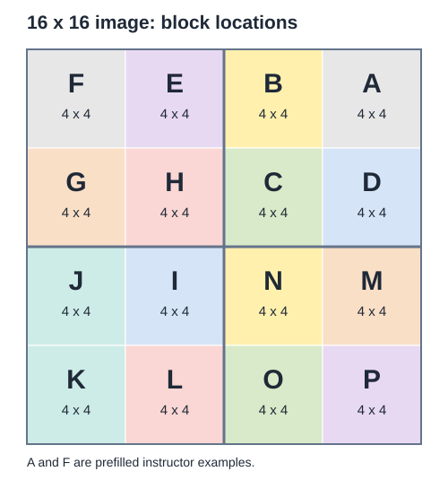

# CSC 101 - Challenge: Quadtree Decoding

Decode a mystery **16 x 16 black-and-white image** together. There are seven students. Each student is responsible for **two 4 x 4 blocks**, or 32 pixels total. Blocks **A and F are already filled in** as examples.

## Shared workbook

- [Student starter workbook](../outputs/quadtree-7-students/quadtree-student-shared.xlsx)
- [Starter PBM file](../outputs/quadtree-7-students/quadtree-starter-16x16.pbm)

Your instructor will provide a shared editing link to the workbook. Work in that shared copy during class so everyone's pieces combine in one image.

The workbook has two sheets:

- **Pixel Grid:** enter your pixels in the colored grid at `A5:P20`. The black-and-white preview to its right updates as you edit.
- **Codes:** find your block encodings and exact cell ranges.

All student blocks begin with placeholder zeros. Enter every pixel of your decoded blocks, including the zeros. Leave the instructor examples and other students' blocks unchanged.

## How to decode

Every code below begins with a **4 x 4** square.

- `0`: the entire current square is white.
- `1`: the entire current square is black.
- `-`: divide the current square into four equal squares, then decode its four children.

Always process the children in this order: **NE (top-right), NW (top-left), SW (bottom-left), SE (bottom-right)**.

```text
       NW: second | NE: first
       ----------+----------
       SW: third | SE: fourth
```

A split of a 4 x 4 square produces four 2 x 2 squares. A split of a 2 x 2 square produces four individual pixels. Finish a nested square completely before moving to the next child of its parent.

The Excel background colors identify which student owns each block. The image itself uses only `0` for white and `1` for black.

## Block locations



The letters follow the same quadrant order at both levels of the image:

```text
Whole image: 16 x 16
  NE: 8 x 8 -> A, B, C, D
  NW: 8 x 8 -> E, F, G, H
  SW: 8 x 8 -> I, J, K, L
  SE: 8 x 8 -> M, N, O, P

Physical layout (top to bottom, left to right):
    F  E | B  A
    G  H | C  D
   ------+------
    J  I | N  M
    K  L | O  P
```

## Student assignments

| Student | Blocks |
|---|---|
| Ollie Batten | H and L |
| Keylon Curry-Stewart | C and O |
| Khalil Fite | B and N |
| Prashie Patel | D and I |
| Elijah Proctor | E and P |
| Holland West | G and M |
| Cirus Wright | J and K |

Each student should decode both blocks independently, draw the two trees, then enter the resulting 4 x 4 pixel grids into the listed cells on **Pixel Grid**.

## Block encodings

| Block | Student | Pixel Grid cells | Encoding |
|---|---|---|---|
| A | Instructor example (prefilled) | `M5:P8` | `-00-01110` |
| B | Khalil Fite | `I5:L8` | `-0-011011` |
| C | Keylon Curry-Stewart | `I9:L12` | `--0010-0001-1000-0100` |
| D | Prashie Patel | `M9:P12` | `-011-1101` |
| E | Elijah Proctor | `E5:H8` | `--1001011` |
| F | Instructor example (prefilled) | `A5:D8` | `-000-1011` |
| G | Holland West | `A9:D12` | `-10-11101` |
| H | Ollie Batten | `E9:H12` | `--0010-0001-1000-0100` |
| I | Prashie Patel | `E13:H16` | `--001100-0111` |
| J | Cirus Wright | `A13:D16` | `-1-011101` |
| K | Cirus Wright | `A17:D20` | `--1101000` |
| L | Ollie Batten | `E17:H20` | `-1100` |
| M | Holland West | `M13:P16` | `--1011110` |
| N | Khalil Fite | `I13:L16` | `-0-0011-10110` |
| O | Keylon Curry-Stewart | `I17:L20` | `-1100` |
| P | Elijah Proctor | `M17:P20` | `-0-111000` |

## Worked example: prefilled block F

The code `-000-1011` means:

1. Split the 4 x 4 square.
2. Its NE, NW, and SW 2 x 2 squares are all white: `0`, `0`, `0`.
3. Its SE square is split again. Read its four pixels in NE, NW, SW, SE order: `1`, `0`, `1`, `1`.

The resulting block, displayed in ordinary row order, is:

```text
0 0 0 0
0 0 0 0
0 0 0 1
0 0 1 1
```

You can check that example in cells `A5:D8`. The order in the code describes quadrants; the rows in Excel display pixels from left to right.

## View the combined image

Use the workbook's live preview while the class works. To export the completed image:

1. On **Pixel Grid**, select **`A1:P20` only**. This includes the PBM header and all 16 rows of pixels.
2. Copy and paste into a plain text editor such as Notepad or Visual Studio Code.
3. Save the file as `mystery.pbm`. In Notepad, choose **All files** so it does not add `.txt`.
4. Open it in the [NetPBM Viewer](https://kylepaulsen.com/stuff/NetpbmViewer/).

Do not include the live preview, block map, student names, or instructions in the copied range.

This activity uses **PBM**, the black-and-white format. Its header is `P1`; `16 16` gives the width and height. A `#` starts a comment that continues to the end of its line.
